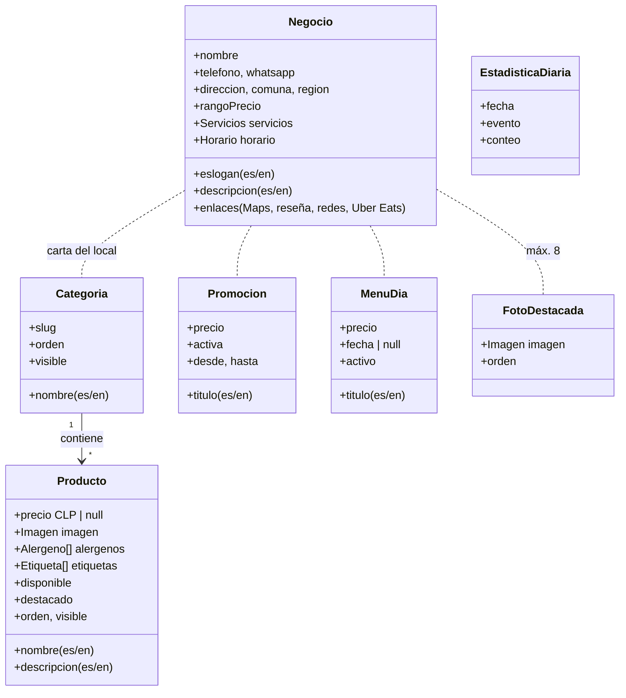

# Modelo de Dominio

## Definición del documento

- **Para qué sirve:** describe los conceptos de negocio, entidades, objetos de valor y relaciones esenciales del dominio, independientes de frameworks o persistencia.
- **Cuándo se crea o actualiza:** durante la fase de Iniciación / Diseño y se refina en Construcción.
- **Qué debe contener:** entidades, atributos, objetos de valor, agregados, relaciones y supuestos del dominio.

---

## 1. Entidades y Agregados

El dominio es la **carta de un local de comida rápida** (ver [DEC-003](./DECISIONES/DEC-003-proposito-carta-digital.md)). Implementado en [`src/lib/db/esquema.ts`](../../src/lib/db/esquema.ts) y [`src/lib/dominio/tipos.ts`](../../src/lib/dominio/tipos.ts).

---

## 2. Definición de Conceptos

- **Negocio:** el local. Tiene una sola instancia, con sus datos de contacto, ubicación, servicios y horario.
- **Categoría:** sección de la carta (Churrascos, Completos y as, …), ordenable y ocultable.
- **Producto:** plato o bebida.
  - `precio = null` se muestra como «Consultar».
  - `disponible = false` es «Agotado»: el producto sigue visible, pero se indica.
  - `destacado` lo lleva al inicio.
- **Promoción:** oferta temporal (p. ej. «Churrascos 2x1») con un rango de fechas opcional.
- **Menú del día:** plato del día. Si `fecha` es nula, se muestra cualquier día mientras esté activo.
- **Foto destacada:** imagen del carrusel superior (máximo 8).
- **Estadística diaria:** contador agregado por día y por evento (`visita`, `qr_escaneo`, `clic_llamar`, …). No guarda datos personales.

### Objetos de valor

- **Horario:** rangos `HH:MM` por día de la semana, en hora de Chile. Si `cierra` es menor que `abre`, el rango cruza la medianoche (p. ej. 12:00–01:00).
- **Servicios:** Wi-Fi, Pet Friendly, Baños, Para llevar y Consumo en el local.
- **Imagen:** URLs WebP en dos tamaños (`sm`, `lg`), dimensiones y texto alternativo en español e inglés.
- **Alérgeno:** lista cerrada (gluten, huevo, leche, soya, maní, frutos secos, pescado, mariscos, sulfitos).
- **Etiqueta:** vegetariano, picante, nuevo.

---

## 3. Estado de Extracción vs Inferencia

- **Extraído:**
  - Datos del local, desde la ficha de Google.
  - Productos, promoción, servicios y eslogan, desde los afiches.
  - Todo cargado en la semilla ([`src/lib/db/semilla.ts`](../../src/lib/db/semilla.ts)).
- **Validado por el responsable:** entidades y alcance del MVP (plan aprobado el 2026-10-22).
- **⚠️ Pendiente de validación humana:**
  - Precios y horario.
  - Productos dentro de «Desayunos» y «Colaciones»; hoy están sin productos.
  - Condiciones del 2x1.
